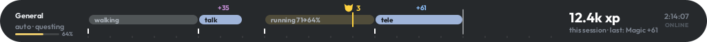
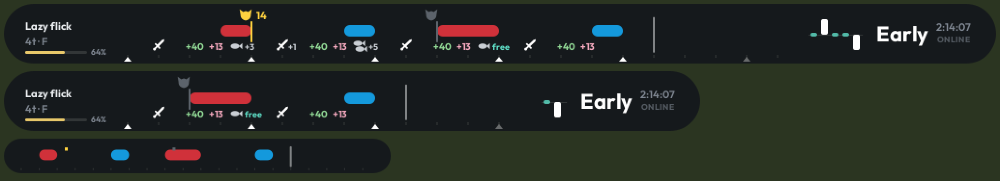
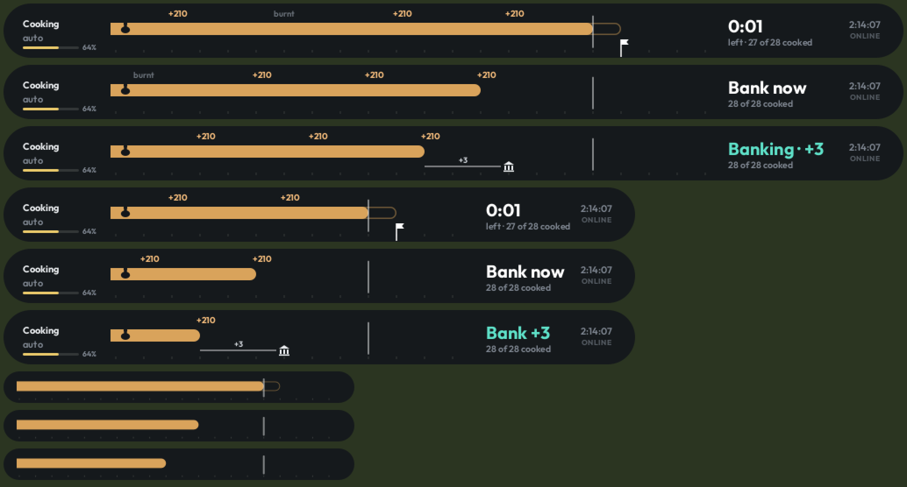
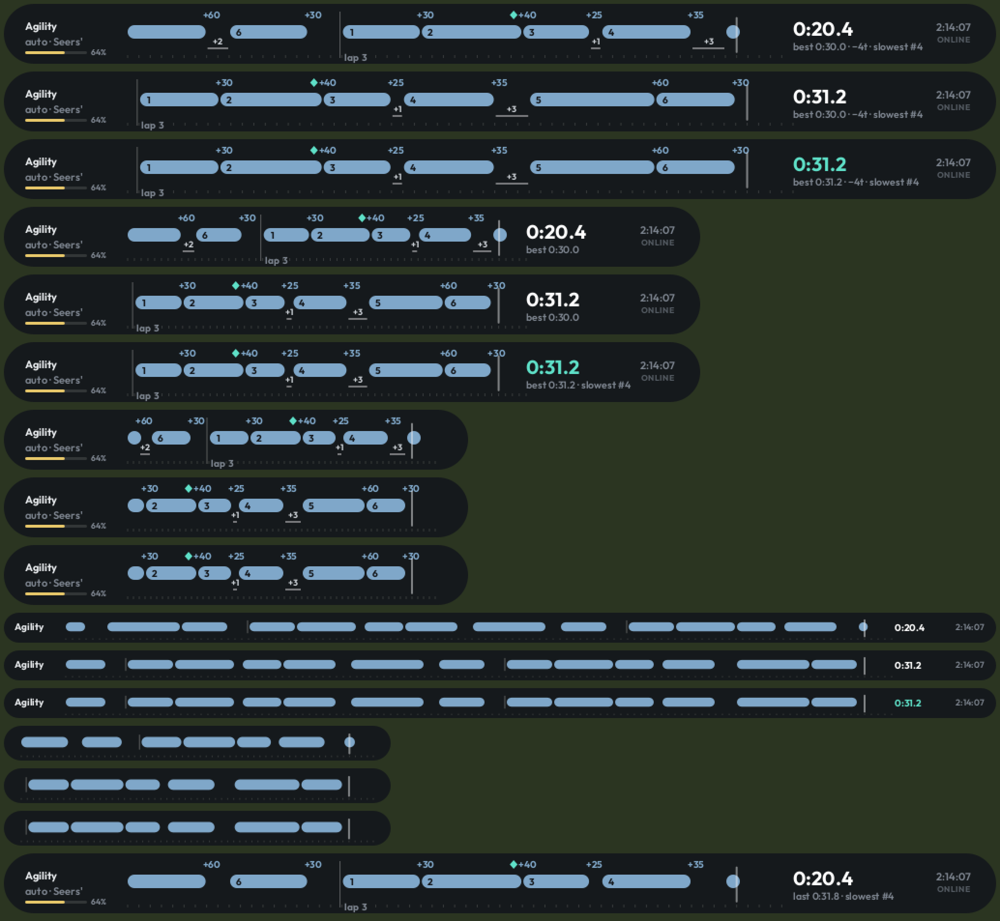
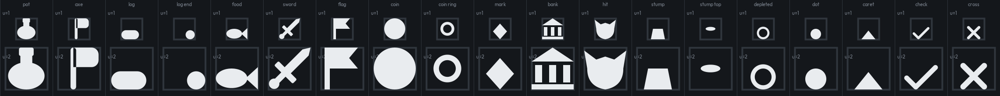

# Super Histogram

A RuneLite plugin: one resizable bar (default 1026 x 62 px, sitting where the chatbox is) that scrolls a tick timeline of what you are doing and what happened to you. It is worth leaving on all the time: it detects your activity and shows the right view, with hits and XP drops above, your own actions in the middle, and your clicks, wasted ticks and finish markers below.

## Modes

- **General (baseline):** faint pill while walking or running, solid pill while animating; XP and hits on top, clicks below. Right: session XP and last drop.
- **AFK:** automatic after 60 s without input. One long pill "idle m:ss since last click"; a mint countdown to the 5-minute idle logout.
- **Minimal:** XP drops only; right shows XP/hr and time to next level.
- **Combat, lazy flick:** your F press starts the beat at weapon speed; prayer pills, hits, attacks and eats (with their attack-timer cost) on the actions row; verdict trail on the right.
- **Combat, 1-tick flick:** a dot per tick placed by in-tick click time (hollow = split, x = skipped, long pill = draining), with a timing histogram and streak.
- **Hull flash on hit:** an enemy's outline flashes yellow and fades over about 0.5 s when its hitsplat lands on you; misses faint grey.
- **Production** (cooking, fletching, herblore, crafting, smithing, bones on altar): inventory pill fills, XP drops, finish flag ahead, exact countdown, white "+N" wasted ticks before the bank click.
- **High alch:** 5-tick cast pills with the coins received per cast; top row Gold, XP or Both.
- **Multi-XP:** each skill's XP as its own coloured number; frequent skills shown as coloured dots.
- **Gathering** (woodcutting, mining, fishing, firemaking): a pill per resource with roll notches, item and XP drops, depletion mark and "+N" re-click delay.
- **Agility:** a pill per obstacle in course order, lap-start line, "+N" ticks stood still, marks of grace; right shows lap time, best lap, ticks lost and slowest obstacle.

## Resizing

Any width and height. Scale `u = height / 62`; tick width `max(18, 32u)`. Detail drops as the bar shrinks: under 56 px tall the actions row is hidden; under 40 px only one row of pills remains; under 720 px wide the right readout is hidden; under 480 px the left readout is hidden.

## Settings

- **Bar:** size, mode (auto or pinned), baseline General, AFK after 60 s, AFK warning, run energy, login time.
- **Feedback:** metronome (Off / Every tick / Cue tick only), blink when done.
- **Combat:** lazy flick, F hotkey, actions row (Off / Attacks / Attacks + eats), eat costs, hull flash (on, not at bosses, misses faint).
- **XP & gold:** numbers or dots, high alch top row, right side per hour.
- **Skilling:** time to finish, "+N" wasted ticks, agility compare (Best / Last).
- **Colours.**

## Rules boundary (Jagex third-party client guidelines)

- Show only what already happened, or what the player started themselves.
- Enemy-tied beats start only from the player's hotkey (default F). The player's own rhythms (weapon speed, skilling actions) may start automatically.
- Never: next-attack prediction, attack counters, prayer suggestions, boss-mechanic timers, projectile or impact locations, or anything indicating which player an NPC is focused on.
- Wintertodt / Tempoross / Guardians of the Rift: only the player's own actions.

## Icons

Every icon is a filled vector shape from one 12 x 12 grid (`ui/Icons.java`).

## Licences

The plugin is released under the BSD 2-Clause licence (see `LICENSE`).

The bar text uses the Outfit font (Regular, SemiBold, Bold), bundled under the SIL Open Font License 1.1. Copyright 2021 The Outfit Project Authors. The licence text is shipped with the font at `src/main/resources/com/superhistogram/OFL.txt`.
