# Super Histogram

A RuneLite plugin that shows a tick timeline of what you're doing: one bar, floating just above the chat by default, that
scrolls one game tick at a time. Hits and XP drops are on top, your own actions are in the middle, and your clicks,
wasted ticks and finish markers are underneath. It works out what you're doing and changes to the view for that
activity, so you can leave it on all the time.

> **What it doesn't do.** It never predicts anything: no next-hit or next-attack timers, no boss mechanic or
> projectile warnings, no prayer suggestions, and nothing about who an enemy is targeting. It never clicks,
> types or acts for you. Everything on the bar is something that already happened, or a beat you started yourself
> with a key press. See [Rules](#rules).

| Combat | Skilling | Minigames |
|:---:|:---:|:---:|
|  |  | 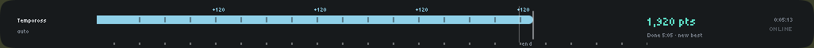 |

## Views

The bar picks the view for you. You can also pin one in the settings.

| View | What it shows |
|---|---|
| **General** | A faint pill while you walk and a solid one while you animate, with XP and hits above and clicks below. Session XP is on the right. |
| **Combat, lazy flick** | Pressing F starts a beat at your weapon's speed. It shows prayer pills, hits, attacks and eats, with the attack time each eat costs, and a running verdict. |
| **Combat, 1-tick flick** | One dot per tick, placed by when in the tick you clicked, with a timing histogram and your streak. |
| **Slayer** | The fight view plus kills left on your task. |
| **Production** (cooking, fletching, herblore, crafting, smithing, Prayer, planks) | Your inventory filling up, the XP drops, an exact countdown to done, and the ticks wasted before you click the bank. |
| **Gathering** (woodcutting, mining, fishing, firemaking, salvaging) | One pill per resource with roll notches, a depletion mark, and how long you took to click again. |
| **High alch** | 5-tick casts with the coins from each one. |
| **Spells** | Casts of any other spell, with their XP. |
| **Agility** | A pill per obstacle, lap times, best lap, ticks spent standing still, and marks of grace. |
| **Thieving** | Pickpockets and stalls, stuns, and coin pouches. |
| **Hunter** | Your traps: set, full and failed. |
| **Runs** (Runecraft, farm and birdhouse runs) | Each trip end to end, with trip time against your best. |
| **Rounds** (Wintertodt, Tempoross, Volcanic Mine) | The whole round: points, round time and your best. |
| **AFK** | Turns on after 60 s without input and counts down to the 5-minute idle logout. |

More screenshots

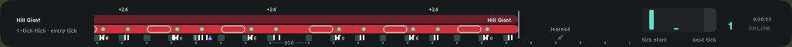
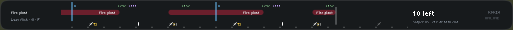
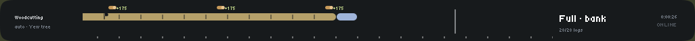
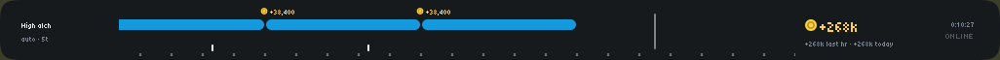
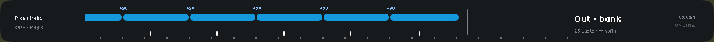

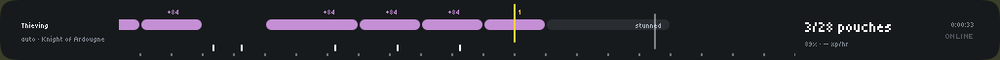
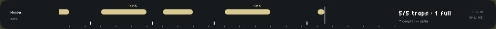
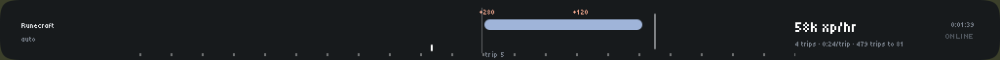
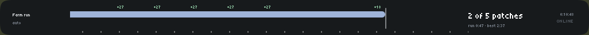
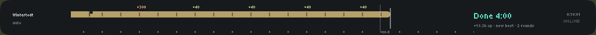

## Size

The bar can be any size. Its default is 1026 x 62 px. Everything scales with its height, and it drops detail as it
shrinks:

- Under 44 px tall, the actions row is hidden.
- Under 40 px tall, only one row of pills is left.
- Under 720 px wide, the side readouts get narrower.
- Under 400 px wide, the right readout is hidden.
- Under 330 px wide, the left readout is hidden.

Edges snap to whole pixels, so lines stay sharp when RuneLite stretches the game.

## Settings

- **Bar:** position, height, the view (auto or pinned), the AFK switch and logout warning, the now-line position, smooth scrolling, and shifting clicks by your ping.
- **Feedback:** the metronome (off, every tick, or only the cue tick) and a blink when you're done.
- **Combat:** prayer mode, the beat hotkey, the actions row, eat costs, the enemy flash when you are hit, and enemies to ignore.
- **XP & gold:** numbers or dots, and what the high alch top row shows.
- **Skilling:** time to finish, wasted ticks, and which agility lap to compare against.
- **Colours:** the bar itself, plus sections for prayer, combat, metronome, bar line and skill colours. These start
  closed.

## Rules

The bar follows Jagex's [third-party client guidelines](https://secure.runescape.com/m=news/third-party-client-guidelines?oldschool=1):

- It shows only what has already happened, or a rhythm you started yourself.
- A beat tied to an enemy only starts when you press the hotkey (F by default). Your own rhythms, like weapon speed
  and skilling actions, can start on their own.
- It never predicts the next attack, counts attacks, suggests prayers, times boss mechanics, shows where
  projectiles will land, or shows who an NPC is focused on.
- At Wintertodt, Tempoross and Guardians of the Rift, it shows only your own actions.

## Report a problem

If a view looks wrong or a number doesn't match the game, please [open an issue](../../issues/new/choose) and pick one of:

- **Wrong view or wrong numbers:** the bar picked the wrong view, or a count or time is off.
- **Something's broken:** errors, a stuck bar, or anything that doesn't work.
- **Idea for a view:** an activity that deserves its own view.

## Credits

Activity details such as tick timings, animations and XP rates come from the
[Old School RuneScape Wiki](https://oldschool.runescape.wiki).

The bar text uses the [Tiny5](https://github.com/Gissio/font_Tiny5) font, bundled under the SIL Open Font License
1.1; see [OFL.txt](src/main/resources/com/superhistogram/OFL.txt). Every icon is drawn in code on one 12 x 12 grid.

Old School RuneScape is the property of Jagex Ltd. This plugin is not affiliated with Jagex.

## Licence

The code is released under the BSD 2-Clause licence; see [LICENSE](LICENSE).
